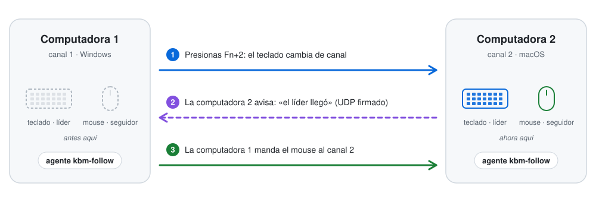
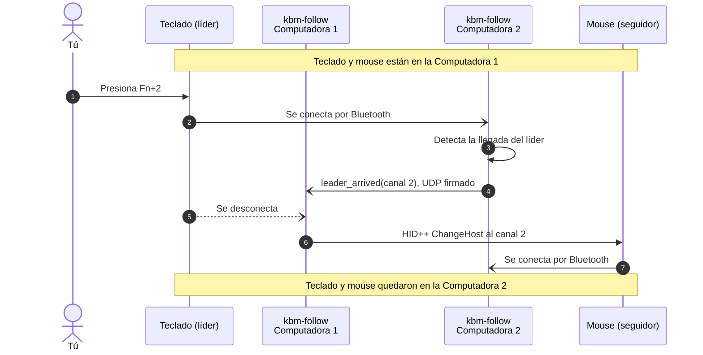
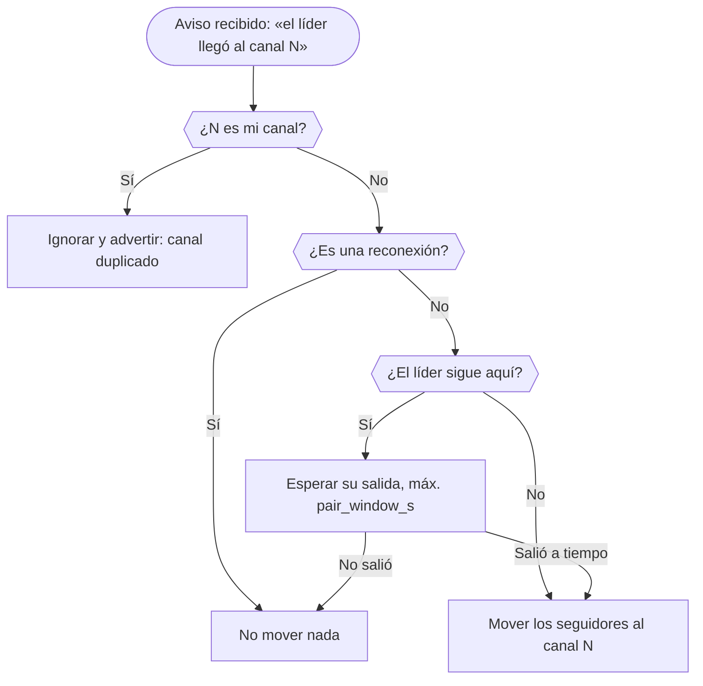
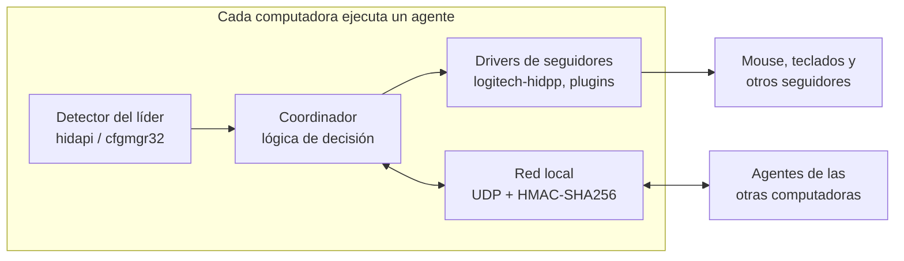

<div align="center">

# kbm-follow

**Presiona la tecla de canal de tu teclado y tu mouse se cambia solo a la otra computadora.**

[](https://github.com/tanoriruizs/kbm-follow/actions/workflows/ci.yml)
[](LICENSE)


<picture>
  <source media="(prefers-color-scheme: dark)" srcset="docs/img/hero-dark.svg">
  
</picture>

</div>

## ¿Por qué lo creé?

Trabajo todos los días con dos computadoras, una con Windows y una Mac, y uso el mismo teclado
y el mismo mouse para las dos: un **AULA F75 Max** y un **Logitech MX Master 3S**, ambos por
Bluetooth. Cada uno puede recordar hasta **3 dispositivos** y cambiar entre ellos, pero cada
uno a su manera: el teclado con `Fn+1` / `Fn+2`, y el mouse con un botón que está *debajo*.

Así que cada cambio de computadora era el mismo ritual: presionar la combinación en el
teclado, levantar el mouse, voltearlo, darle al botón hasta llegar al canal correcto y volver
a acomodarlo. Varias veces al día. Y como son de marcas distintas, no hay forma de que el
teclado le avise al mouse que ya cambié de computadora.

kbm-follow nació para quitarme ese paso. Ahora solo presiono `Fn+2` y, un segundo después, el
mouse llega solo a la otra computadora. Lo hice genérico para que también te sirva a ti con
tus propios dispositivos, sean de la marca que sean.

## ¿Qué hace?

Tú cambias **un** dispositivo a mano (el **líder**, en mi caso el teclado) y los demás (los
**seguidores**, en mi caso el mouse) se cambian solos al mismo canal, en uno o dos segundos.

> [!NOTE]
> kbm-follow no reenvía tu teclado ni tu mouse por la red: cada dispositivo sigue
> **conectado por Bluetooth directamente** a la computadora que usas. Solo automatiza el
> cambio de canal, así que no agrega retraso a lo que escribes ni a los movimientos del mouse.

## Contenido

- [Conceptos](#conceptos)
- [Características](#características)
- [Cómo funciona](#cómo-funciona)
- [Compatibilidad](#compatibilidad)
- [Requisitos](#requisitos)
- [Instalación paso a paso](#instalación-paso-a-paso)
- [Configuración](#configuración)
- [Comandos](#comandos)
- [Ejecución en segundo plano](#ejecución-en-segundo-plano)
- [Solución de problemas](#solución-de-problemas)
- [Seguridad](#seguridad)
- [Crear un driver para otra marca](#crear-un-driver-para-otra-marca)
- [Estructura del proyecto](#estructura-del-proyecto)
- [Hoja de ruta](#hoja-de-ruta)
- [Preguntas frecuentes](#preguntas-frecuentes)
- [Contribuir](#contribuir)
- [Agradecimientos](#agradecimientos)
- [Aviso legal](#aviso-legal)
- [Licencia](#licencia)

## Conceptos

| Término | Qué es | Ejemplo |
|---|---|---|
| **Líder** | El dispositivo que cambias a mano con su tecla o botón de canal. kbm-follow solo lo *observa*. | Teclado AULA F75 Max |
| **Seguidor** | Un dispositivo que kbm-follow cambia de canal por ti mediante un *driver*. | Mouse Logitech MX Master 3S |
| **Canal** | La posición que ocupa cada computadora en tus dispositivos (1, 2, 3…). | Windows = 1, Mac = 2 |
| **Agente** | El programa de kbm-follow que corre en segundo plano en **cada** computadora. | `kbm-follow run` |

## Características

- **Cualquier marca como líder.** Sirve cualquier teclado o mouse Bluetooth cuya conexión vea
  el sistema operativo (AULA, Keychron, Logitech…). No necesita drivers ni software.
- **Drivers de seguidores como plugins.** Logitech HID++ (MX Master, MX Anywhere, MX Keys,
  Lift…) viene incluido. Otras marcas se agregan como paquetes aparte, sin tocar el núcleo.
- **Varios seguidores a la vez.** Por ejemplo, un mouse *y* un segundo teclado.
- **A prueba de suspensión.** Si el líder se duerme y despierta en la misma computadora,
  nada se mueve. Los seguidores solo cambian cuando otra computadora confirma que el líder
  llegó a ella.
- **Sin nube ni cuentas.** Las computadoras hablan directamente en tu red local con mensajes
  firmados (HMAC-SHA256). Nada sale de tu red y no hay telemetría.
- **Corre en segundo plano.** Instaladores para Windows (tarea programada) y macOS
  (LaunchAgent): arranca al iniciar sesión, se reinicia si falla y guarda un registro.
- **Ligero.** Python puro con una sola dependencia (`hidapi`).

## Cómo funciona

Cada computadora ejecuta un agente con su propio número de **canal**. Así se ve un cambio
completo, desde que presionas la tecla hasta que el mouse llega:



1. **Detectar.** Cada agente revisa si el líder está conectado *a esa computadora*. En macOS y
   Linux lo busca por nombre con `hidapi`; en Windows busca su VID:PID en la lista de
   interfaces del sistema, sin abrir el dispositivo, para no estorbar su reconexión Bluetooth.
2. **Anunciar.** Cuando el líder *llega* a una computadora, su agente envía a la red local un
   mensaje firmado: «el líder llegó al canal N».
3. **Seguir.** El agente de la computadora que tiene a los seguidores les ordena cambiarse a
   ese canal. Solo la computadora a la que está conectado un dispositivo puede mandarle
   comandos; por eso hay un agente en cada computadora.

### ¿Por qué no se mueve nada cuando el teclado se duerme?

Muchos teclados se desconectan al dormirse y se reconectan al despertar. Si kbm-follow
reaccionara a las *desconexiones*, el mouse saltaría a otra computadora cada vez que dejas de
escribir. Por eso solo reacciona a las *llegadas confirmadas* y sigue estas reglas:



- **Reconexión:** cada agente recuerda dónde se vio el líder por última vez. Si vuelve a la
  misma computadora (despertó), el aviso se marca como reconexión y nadie mueve nada.
- **Espera:** Windows puede tardar un momento en notar que el líder se fue, así que un aviso
  que llega antes se guarda hasta `pair_window_s` segundos (8 por defecto).

### Arquitectura



## Compatibilidad

### Líder

Cualquier dispositivo **Bluetooth** multi-host cuya conexión vea el sistema operativo. Usa
`kbm-follow devices` para ver su nombre y su VID:PID.

> [!IMPORTANT]
> El líder debe conectarse por **Bluetooth**. Con dongle USB o cable siempre aparece como
> conectado, así que kbm-follow no puede saber cuándo cambiaste de computadora.

### Seguidores

Un seguidor necesita un driver que sepa enviarle la orden «cámbiate al canal N». La mayoría de
las marcas no documenta esa orden, así que el soporte crece con la comunidad.

| Driver | Dispositivos | Conexión | Estado |
|---|---|---|---|
| `logitech-hidpp` | Logitech HID++ 2.0 con Easy-Switch (función `0x1814`): MX Master 3/3S, MX Anywhere 3/3S, MX Keys / Keys S, MX Mechanical, Lift, entre otros | Bluetooth | ✅ Incluido |
| `logitech-hidpp` | Los mismos, a través de receptor Bolt o Unifying | Receptor USB | 🚧 Planeado |
| *¿tu marca?* | — | — | [Crea un driver](#crear-un-driver-para-otra-marca) |

> [!TIP]
> ¿Tu mouse no tiene driver pero tu teclado sí (por ejemplo, un MX Keys)? Invierte los papeles:
> el mouse es el líder y el teclado el seguidor.

### Combinaciones probadas

| Líder | Seguidores | Computadoras |
|---|---|---|
| AULA F75 Max (Bluetooth) | Logitech MX Master 3S (Bluetooth) | Windows 11 (Python 3.14) ↔ macOS (Python 3.13) |

En la familia Logitech solo se ha probado el MX Master 3S; se espera que los demás modelos con
Easy-Switch funcionen igual. ¿Probaste otra combinación?
[Abre un issue](../../issues/new) contándolo para ampliar esta tabla.

### Sistemas operativos

| Sistema | Estado | Notas |
|---|---|---|
| Windows 10 / 11 | ✅ Soportado | Instalador con tarea programada |
| macOS | ✅ Soportado | Instalador con LaunchAgent |
| Linux | 🧪 Experimental | Requiere reglas udev; aún sin instalador |

## Requisitos

- **Python 3.9 o superior** en cada computadora.
- Todas las computadoras en la **misma red local** (puerto UDP `47809` por defecto).
- **El mismo número de canal en todos los dispositivos** para cada computadora: si Windows es
  el canal 1 en el teclado, también debe serlo en el mouse. Si algún dispositivo numera
  distinto, usa [`channel_map`](#channel_map).
- El líder y los seguidores conectados por **Bluetooth**.

## Instalación paso a paso

El ejemplo usa dos computadoras: **Windows en el canal 1** y **macOS en el canal 2**, un
teclado **AULA F75 Max** como líder y un **Logitech MX Master 3S** como seguidor. Cambia los
nombres por los de tus dispositivos.

### 1. Descarga el código en cada computadora

```bash
git clone https://github.com/tanoriruizs/kbm-follow.git
cd kbm-follow
```

> [!WARNING]
> **macOS:** clónalo **fuera** de Documentos, Escritorio y Descargas (por ejemplo en
> `~/kbm-follow`). macOS no deja que los procesos en segundo plano lean esas carpetas.
>
> **Windows:** evita carpetas sincronizadas con OneDrive; no se llevan bien con los entornos
> virtuales de Python.

### 2. Instala el paquete

<details open>
<summary><b>Windows (PowerShell)</b></summary>

```powershell
py -3 -m venv .venv
.venv\Scripts\pip install -e .
```

</details>

<details open>
<summary><b>macOS / Linux</b></summary>

```bash
python3 -m venv .venv
.venv/bin/pip install -e .
```

</details>

En los pasos siguientes, `kbm-follow` equivale a `.venv\Scripts\kbm-follow` en Windows o a
`.venv/bin/kbm-follow` en macOS y Linux. También puedes activar el entorno virtual y escribir
solo `kbm-follow`.

### 3. Identifica tus dispositivos

Con el teclado y el mouse conectados por Bluetooth a esta computadora:

```bash
kbm-follow devices
```

```text
NAME                             VID:PID    USAGES (* = Logitech HID++, usable by logitech-hidpp)
AULA F75Max-1                    05AC:024F  0001:0006 000C:0001 ...
MX Master 3S                     046D:B034  0001:0002 FF43:0202*
```

Elige un texto que identifique a cada uno, por ejemplo `F75` y `MX Master 3S`. El asterisco
indica que ese dispositivo es compatible con el driver `logitech-hidpp`.

### 4. Configura la primera computadora (Windows, canal 1)

```powershell
kbm-follow init --channel 1 --leader "F75" --follower "logitech-hidpp:MX Master 3S"
```

En Windows, `init` también detecta el VID:PID del líder (déjalo conectado). Al terminar imprime
un **secreto compartido**: cópialo para el siguiente paso.

### 5. Configura la segunda computadora (macOS, canal 2)

```bash
kbm-follow init --channel 2 --leader "F75" \
  --follower "logitech-hidpp:MX Master 3S" --secret <SECRETO-DEL-PASO-4>
```

### 6. Pruébalo en primer plano

Ejecuta en **las dos** computadoras:

```bash
kbm-follow run
```

Presiona varias veces la tecla de canal del líder. En el registro verás algo así:

```text
INFO    Leader DISCONNECTED from here
INFO    Leader arrived at 'MacBook' (channel 2)
INFO    Logitech 'MX Master 3S': sent to channel 2
```

Cuando todo funcione, detén los agentes con `Ctrl+C`.

### 7. Instálalo como servicio en segundo plano

<details open>
<summary><b>Windows</b>: PowerShell <b>como administrador</b> (para abrir el puerto en el firewall)</summary>

```powershell
powershell -ExecutionPolicy Bypass -File .\install\windows\install.ps1
```

</details>

<details open>
<summary><b>macOS</b></summary>

```bash
chmod +x install/macos/*.sh && install/macos/install.sh
```

Si macOS pregunta si Python puede buscar dispositivos en la red local, elige **Permitir**.

</details>

### 8. Verifica la conexión entre computadoras

```bash
kbm-follow ping
```

El registro de la **otra** computadora debe mostrar `Ping received from '…'`. ¡Listo!

## Configuración

`kbm-follow init` crea el archivo por ti. Después puedes editarlo para ajustar detalles.

| Sistema | Archivo de configuración | Registro |
|---|---|---|
| Windows | `%APPDATA%\kbm-follow\config.json` | `%LOCALAPPDATA%\kbm-follow\kbm-follow.log` |
| macOS | `~/Library/Application Support/kbm-follow/config.json` | `~/Library/Logs/kbm-follow.log` |
| Linux | `~/.config/kbm-follow/config.json` | `~/.local/state/kbm-follow/kbm-follow.log` |

Ejemplo completo (con un segundo seguidor que usa `channel_map`):

```json
{
  "version": 1,
  "name": "laptop-trabajo",
  "channel": 1,
  "secret": "PEGA-AQUI-EL-SECRETO-QUE-IMPRIME-init",
  "port": 47809,
  "broadcast": true,
  "peers": [],
  "poll_interval_s": 0.5,
  "debounce_polls": 2,
  "pair_window_s": 8.0,
  "leader": { "match": "F75", "windows_id": "05AC:024F" },
  "followers": [
    { "driver": "logitech-hidpp", "match": "MX Master 3S" },
    { "driver": "logitech-hidpp", "match": "MX Keys", "channel_map": { "1": 1, "2": 3 } }
  ]
}
```

### Claves principales

| Clave | Por defecto | Descripción |
|---|---|---|
| `channel` | obligatoria | Canal que ocupa esta computadora en tus dispositivos (1 a 6). |
| `secret` | obligatoria | Secreto compartido, idéntico en todas las computadoras (16 caracteres o más). |
| `leader` | obligatoria | El dispositivo que cambias a mano. [Ver abajo](#leader). |
| `followers` | obligatoria | Los dispositivos que siguen al líder. [Ver abajo](#followers). |
| `name` | nombre del equipo | Cómo aparece esta computadora en los registros de las demás. |
| `port` | `47809` | Puerto UDP que usan todas las computadoras. |
| `broadcast` | `true` | Enviar los avisos a toda la red local. |
| `peers` | `[]` | IPs o nombres de las otras computadoras. Úsalo si tu router bloquea el broadcast. |
| `poll_interval_s` | `0.5` | Cada cuántos segundos se revisa si el líder está conectado. |
| `debounce_polls` | `2` | Lecturas iguales seguidas para confirmar un cambio. |
| `pair_window_s` | `8.0` | Segundos máximos entre «el líder llegó allá» y «el líder se fue de aquí». |
| `version` | `1` | Versión del formato del archivo. |

### `leader`

| Clave | Descripción |
|---|---|
| `match` | Texto contenido en el nombre del líder. No distingue mayúsculas, espacios ni `_`. |
| `windows_id` | Solo Windows: VID:PID de las interfaces **Bluetooth** del líder. Muy recomendable: sin él, Windows recurre a `hidapi`, que abre los dispositivos y puede estorbar la reconexión del líder. |

### `followers`

Cada seguidor es un objeto con un `driver`, las opciones propias de ese driver y, de forma
opcional, un `channel_map`.

| Clave | Descripción |
|---|---|
| `driver` | Nombre del driver. `kbm-follow drivers` muestra los instalados. |
| *opciones del driver* | Para `logitech-hidpp`: `match`, el texto contenido en el nombre del dispositivo. |
| `channel_map` | Opcional. Traduce los canales de esta configuración a las posiciones del dispositivo. |

#### `channel_map`

Si en cierto dispositivo la computadora 2 ocupa la posición **3**, agrega
`"channel_map": { "2": 3 }` a ese seguidor **en todas las computadoras**. Los canales que no
aparecen se usan tal cual.

> [!TIP]
> Después de editar la configuración, reinicia el agente
> ([ver cómo](#ejecución-en-segundo-plano)).

## Comandos

Todos los comandos aceptan `-v` (registro detallado) y `--config RUTA`.

| Comando | Qué hace |
|---|---|
| `kbm-follow init --channel N --leader NOMBRE --follower DRIVER:NOMBRE` | Crea la configuración de esta computadora. Opciones: `--secret`, `--name`, `--leader-windows-id VID:PID`, `--force`. `--follower` se puede repetir. |
| `kbm-follow status` | Muestra la configuración y las rutas (sin imprimir el secreto). |
| `kbm-follow run` | Ejecuta el agente en primer plano; es lo mismo que ejecutan los instaladores. |
| `kbm-follow ping` | Envía un mensaje de prueba; las otras computadoras registran `Ping received`. |
| `kbm-follow devices [--all]` | Lista los dispositivos HID conectados con nombre, VID:PID y usos. |
| `kbm-follow drivers` | Lista los drivers de seguidores instalados. |
| `kbm-follow followers` | Muestra cada seguidor y su canal actual. |
| `kbm-follow switch --to N [--follower I]` | Cambia los seguidores a mano; útil para probar. |

`python -m kbm_follow …` funciona igual que `kbm-follow …`.

## Ejecución en segundo plano

| | Windows | macOS |
|---|---|---|
| Mecanismo | Tarea programada `kbm-follow` (al iniciar sesión, sin ventana) | LaunchAgent `com.kbmfollow.agent` |
| Instalar | `install\windows\install.ps1` | `install/macos/install.sh` |
| Desinstalar | `install\windows\uninstall.ps1` | `install/macos/uninstall.sh` |
| Reiniciar | `Stop-ScheduledTask kbm-follow; Start-ScheduledTask kbm-follow` | `launchctl kickstart -k gui/$(id -u)/com.kbmfollow.agent` |
| Ver el registro en vivo | `Get-Content $env:LOCALAPPDATA\kbm-follow\kbm-follow.log -Wait -Tail 20` | `tail -f ~/Library/Logs/kbm-follow.log` |

Los dos reinician el agente si falla. Al desinstalar se conservan la configuración y los
registros.

<details>
<summary><b>Linux (experimental)</b></summary>

Todavía no hay instalador. Da a tu usuario acceso a los dispositivos `hidraw`, por ejemplo con
`/etc/udev/rules.d/70-kbm-follow.rules` (adaptado de las reglas de
[Solaar](https://github.com/pwr-Solaar/Solaar)):

```text
# Logitech por USB y Bluetooth
KERNEL=="hidraw*", SUBSYSTEM=="hidraw", ATTRS{idVendor}=="046d", TAG+="uaccess"
KERNEL=="hidraw*", SUBSYSTEM=="hidraw", KERNELS=="0005:046D:*", TAG+="uaccess"
```

Recarga las reglas con `sudo udevadm control --reload && sudo udevadm trigger` y ejecuta
`kbm-follow run` desde un servicio de usuario de systemd. Se agradecen pruebas y un instalador.

</details>

## Solución de problemas

| Síntoma | Causa probable y solución |
|---|---|
| Nunca aparece `Ping received` | Las computadoras no se alcanzan por UDP `47809`. En Windows, confirma que la red sea **Privada** y vuelve a ejecutar el instalador como administrador. Algunos routers bloquean el broadcast o aíslan a los clientes Wi-Fi: agrega la IP de la otra computadora en `peers`. |
| `bad signature` en el registro (con `-v`) | El `secret` no es igual en todas las computadoras. |
| `stale message or clocks out of sync` | Los relojes difieren más de 30 segundos. Activa la hora automática. |
| Windows nunca detecta al líder | Compara `leader.windows_id` con `kbm-follow devices` teniendo el líder conectado **por Bluetooth** (por cable o dongle el VID:PID es otro). |
| El líder se queda "en el limbo" entre computadoras | Falta `windows_id` en Windows, así que se usa `hidapi`, que abre dispositivos al revisar. Configúralo. |
| Un seguidor dice `not connected to this computer` | Es normal en la computadora que no lo tiene. Si sí está conectado, revisa su `match` con `kbm-follow devices`. |
| Un dispositivo Logitech deja de responder en Windows | A veces Windows no inicializa bien el canal de control Bluetooth LE. Apaga y enciende el Bluetooth. |
| `Cannot use UDP port 47809` | Ya hay otro agente corriendo, por ejemplo el servicio mientras pruebas con `kbm-follow run`. |
| En macOS no pasa nada después de instalar | Verifica que el proyecto no esté en Documentos, Escritorio ni Descargas, y revisa `~/Library/Logs/kbm-follow.launchd.log`. |

¿Nada de esto aplica? Ejecuta `kbm-follow -v run` en las dos computadoras, reproduce el
problema y [abre un issue](../../issues/new) con ambos registros.

## Seguridad

- Cada mensaje va firmado con **HMAC-SHA256** usando el secreto compartido, lleva marca de
  tiempo (margen de ±30 segundos) y un identificador aleatorio. Se descartan los mensajes
  falsificados, alterados, vencidos o repetidos.
- Los mensajes **no van cifrados** porque no contienen nada sensible: solo dicen «el líder
  llegó al canal N».
- El secreto vive en tu configuración de usuario (con permisos `600` en macOS y Linux), nunca
  en el repositorio. Para cambiarlo, ejecuta `kbm-follow init --force` en todas las computadoras.
- El tráfico nunca sale de tu red local.

## Crear un driver para otra marca

Un driver es una clase de Python pequeña. Puede vivir en su propio paquete y registrarse con un
*entry point*, así que no necesitas hacer fork de este proyecto:

```python
from kbm_follow.drivers import FollowerDriver, SwitchResult


class AcmeMouseDriver(FollowerDriver):
    OPTIONS = {"match": str}
    REQUIRED_OPTIONS = frozenset({"match"})

    @property
    def description(self) -> str:
        return f"Acme '{self.options['match']}'"

    def switch_to(self, channel: int) -> SwitchResult:
        device = buscar_dispositivo(self.options["match"])  # tu código
        if device is None:
            return SwitchResult.NOT_HERE
        device.enviar_cambio_de_canal(channel)              # tu código
        return SwitchResult.SWITCHED
```

```toml
# pyproject.toml de tu paquete
[project.entry-points."kbm_follow.drivers"]
acme-mouse = "kbm_follow_acme:AcmeMouseDriver"
```

Instálalo en el mismo entorno virtual (`pip install -e ../kbm-follow-acme`), revisa que
aparezca en `kbm-follow drivers` y usa `"driver": "acme-mouse"` en la configuración.

### Lo que debe cumplir un driver

| Miembro | ¿Obligatorio? | Qué hace |
|---|---|---|
| `OPTIONS` | Sí | Opciones que acepta en el JSON, `{"nombre": tipo}`. La clase base las valida. |
| `REQUIRED_OPTIONS` | No | Cuáles de esas opciones son obligatorias. |
| `description` | Sí | Nombre corto para los registros, p. ej. `"Acme 'Pro Mouse'"`. |
| `switch_to(channel)` | Sí | Pide al dispositivo cambiarse a `channel` (ya traducido por `channel_map`). Devuelve `SWITCHED`, `ALREADY_THERE` o `NOT_HERE`. |
| `current_channel()` | No | Canal actual, o `None` si no se sabe. Lo usa `kbm-follow followers`. |

- Si el dispositivo **no está conectado** a esa computadora, devuelve `NOT_HERE`; no lances
  un error. Eso pasa en cada cambio en todas las computadoras menos una.
- Para errores de verdad lanza `KbmError` (o deja pasar el `OSError`). El agente reintenta una
  vez y sigue con los demás seguidores.
- Abre el dispositivo, manda la orden y ciérralo. No lo dejes abierto: va y viene entre
  computadoras.
- Responde rápido, idealmente en menos de 2 segundos.

### ¿Cómo descubro la orden de mi dispositivo?

Casi ningún fabricante la documenta. Lo que suele funcionar:

1. **Buscar trabajo previo:** herramientas de código abierto para tu marca (Solaar para
   Logitech, OpenRazer para Razer) o el firmware si es un teclado QMK/ZMK.
2. **Espiar la app oficial:** si el software del fabricante puede cambiar el canal, captura el
   tráfico HID mientras lo hace (Wireshark con USBPcap en Windows, `usbmon` en Linux,
   PacketLogger en macOS para Bluetooth) y repite ese reporte.
3. **Revisar el descriptor HID:** `kbm-follow devices --all` muestra las páginas de uso; las
   del fabricante (`FFxx`) suelen ser donde viven esas órdenes.

> [!CAUTION]
> Mandar reportes al azar a un dispositivo puede cambiar su configuración. Prueba con cuidado
> y nunca envíes órdenes de actualización de firmware.

## Estructura del proyecto

```text
kbm-follow/
├── kbm_follow/
│   ├── __main__.py            # Línea de comandos (kbm-follow …)
│   ├── agent.py               # Coordinador (lógica de decisión) y agente (hilos, red)
│   ├── config.py              # Configuración JSON, validación y rutas por sistema
│   ├── leader.py              # Detección del líder y filtro de rebotes
│   ├── net.py                 # Mensajes UDP firmados y protección contra repeticiones
│   └── drivers/
│       ├── __init__.py        # Clase base FollowerDriver y registro de drivers
│       └── logitech_hidpp.py  # Driver Logitech HID++ 2.0
├── install/                   # Instaladores para Windows y macOS
├── docs/img/                  # Imágenes del README (tema claro y oscuro)
└── tests/                     # Pruebas que no requieren hardware
```

## Hoja de ruta

- [ ] Soporte para receptores Logitech Bolt y Unifying.
- [ ] Driver `ddc-monitor`: cambiar también la entrada del monitor (DDC/CI) para tener un KVM por software completo.
- [ ] Asistente interactivo `kbm-follow setup`.
- [ ] Instalador para Linux (servicio de usuario systemd y reglas udev).
- [ ] Detección del líder por eventos del sistema en lugar de revisiones periódicas.
- [ ] Publicación en PyPI.

## Preguntas frecuentes

<details>
<summary><b>¿En qué se diferencia de Logitech Flow, Deskflow/Barrier o Mouse without Borders?</b></summary>

Esas herramientas comparten un solo teclado y mouse **por la red**: los dispositivos siguen
conectados a una computadora y la entrada se reenvía a las demás. kbm-follow mantiene cada
dispositivo **conectado de forma nativa** a la computadora que usas, sin software en medio de
lo que escribes, y solo automatiza el cambio de canal.

</details>

<details>
<summary><b>¿El líder puede ser un mouse?</b></summary>

Sí. Cualquier dispositivo Bluetooth cuya conexión vea el sistema operativo.

</details>

<details>
<summary><b>¿Funciona con más de dos computadoras?</b></summary>

Sí. Asigna a cada computadora su propio `channel`; el líder decide a dónde va todo.

</details>

<details>
<summary><b>¿El líder necesita algún software o driver?</b></summary>

No. kbm-follow solo observa cuándo se conecta y se desconecta.

</details>

<details>
<summary><b>¿Funciona si el líder usa un dongle USB?</b></summary>

No. El dongle siempre está conectado, así que el sistema nunca ve que el dispositivo se va.
Usa Bluetooth para el líder.

</details>

<details>
<summary><b>¿Qué pasa si una computadora está apagada o dormida?</b></summary>

Nada malo: nadie anuncia una llegada y los seguidores se quedan donde están. Cuando vuelva a
encenderse, su agente arranca solo.

</details>

## Contribuir

Lo que más ayuda: **contar qué dispositivos te funcionaron** (abre un issue con la salida de
`kbm-follow devices`) y **drivers para otras marcas**.

Para preparar el entorno y correr las pruebas (no necesitan hardware; incluyen dos agentes
reales hablando por la red local):

```bash
git clone https://github.com/tanoriruizs/kbm-follow.git
cd kbm-follow
python3 -m venv .venv
.venv/bin/pip install -e .          # Windows: .venv\Scripts\pip install -e .
.venv/bin/python -m unittest discover -s tests -v
```

Algunas reglas para mantener el proyecto sano:

- Compatible con **Python 3.9** (la versión que trae macOS): sin `match` y sin tipos `X | Y`
  fuera de las anotaciones.
- Sin dependencias nuevas sin platicarlo antes; hoy la única es `hidapi`.
- Cada cambio de comportamiento con su prueba.
- Nunca subas ni registres el secreto.

Al enviar un pull request aceptas que tu código se publique bajo la licencia MIT.

## Agradecimientos

- [Solaar](https://github.com/pwr-Solaar/Solaar), cuyo trabajo documentó el protocolo HID++ de Logitech.
- [hidapi](https://github.com/libusb/hidapi) y sus [bindings para Python](https://github.com/trezor/cython-hidapi).

## Aviso legal

kbm-follow es un proyecto independiente y **no está afiliado, respaldado ni patrocinado por**
Logitech, AULA, Epomaker ni ningún otro fabricante. Los nombres de productos y marcas
pertenecen a sus respectivos dueños y se mencionan solo para describir la compatibilidad. La
implementación de HID++ se basa en trabajos públicos de ingeniería inversa. Úsalo bajo tu
propio riesgo.

## Licencia

Distribuido bajo la [licencia MIT](LICENSE).
© 2026 [Sebastian Guadalupe Tanori Ruiz](https://github.com/tanoriruizs).
